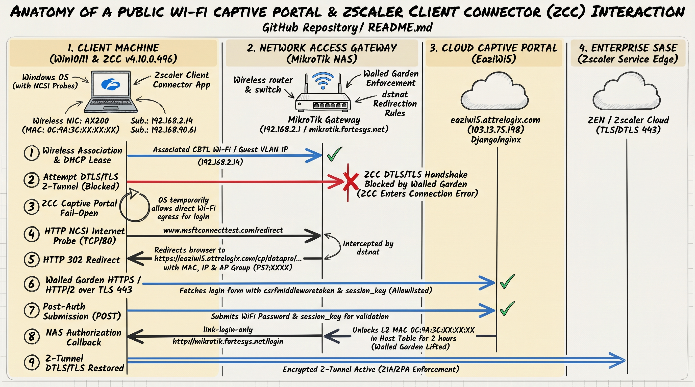
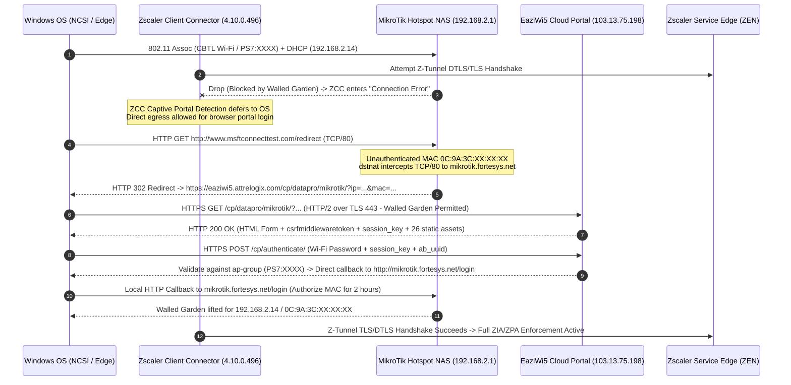
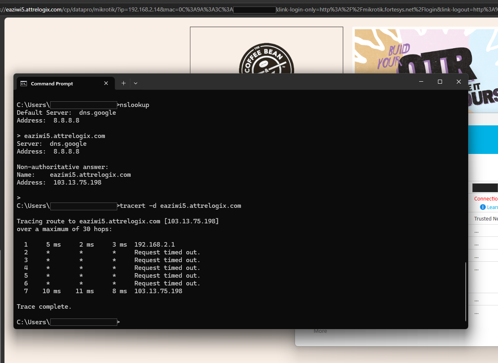
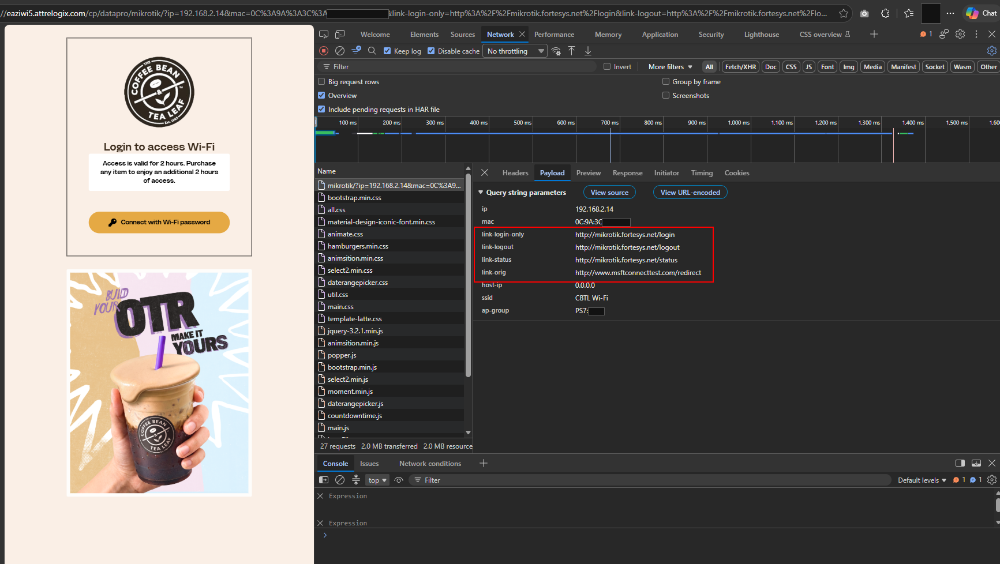
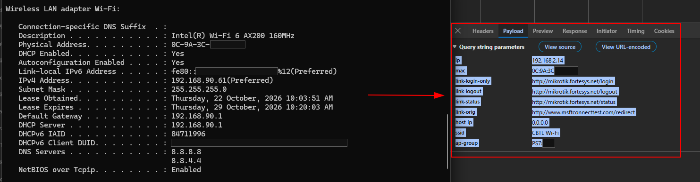
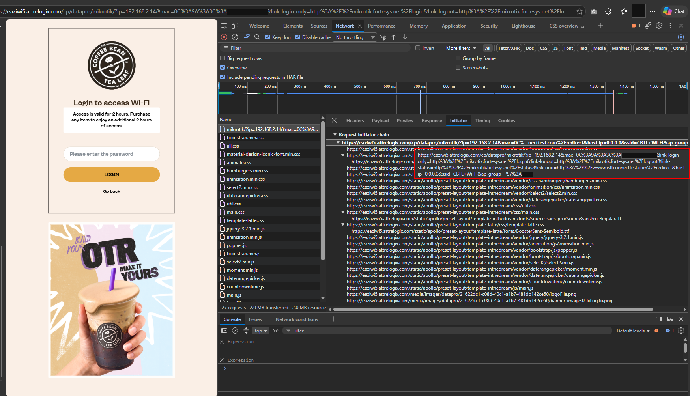
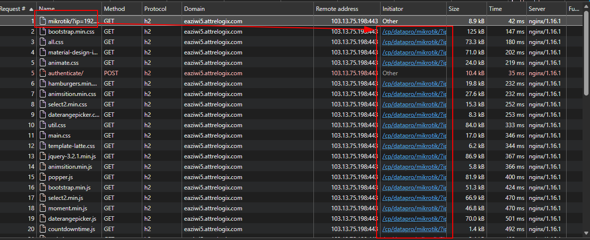

# Anatomy of a Cloud-Hosted Captive Portal & Zscaler Client Connector Interaction (CBTL Wi-Fi / MikroTik)

## 1. Executive Summary
When an enterprise Windows endpoint running **Zscaler Client Connector (ZCC v4.10.0.496)** associates with a public captive-portal Wi-Fi network—specifically **The Coffee Bean & Tea Leaf (`CBTL Wi-Fi`)**—ZCC immediately enters a **Connection Error** state. Pre-authentication firewall rules ("Walled Garden") enforced by the local **MikroTik Hotspot NAS** drop all outbound public internet and Z-Tunnel traffic, permitting egress only to DNS and the external cloud captive portal (`eaziwi5.attrelogix.com` / `103.13.75.198`).

This technical write-up reconstructs the full end-to-end packet, routing, OS probe, and HTTP/2 redirection flow across every layer of the stack using browser HAR telemetry and Windows endpoint diagnostics.

---

## 2. Environment & Sanitized Telemetry

| Component | Observed Value (Sanitized) |
| :--- | :--- |
| **Endpoint OS & Browser** | Windows 10/11 (x64), Microsoft Edge v155 (Chromium) |
| **SASE Agent** | Zscaler Client Connector (ZCC) `v4.10.0.496` |
| **Wireless NIC & Hardware MAC** | `Intel(R) Wi-Fi 6 AX200 160MHz` / `0C:9A:3C:XX:XX:XX` |
| **Client IPv4 & Gateway (Capture VLAN)** | `192.168.2.14/24` -> Gateway `192.168.2.1` *(multi-VLAN guest topology; alternate VLAN lease `192.168.90.61/24` via `192.168.90.1` also observed)* |
| **Configured DNS Servers** | `8.8.8.8`, `8.8.4.4` (`dns.google`) |
| **Wireless SSID & AP Group** | `CBTL Wi-Fi` / `PS7:XXXX` |
| **Local Hotspot Controller (NAS)** | `mikrotik.fortesys.net` (Local `/login`, `/logout`, `/status` endpoints) |
| **External Cloud Captive Portal** | `eaziwi5.attrelogix.com` (`103.13.75.198`, TCP/443, HTTP/2) |
| **Portal Web Stack** | `nginx/1.16.1`, Django CSRF middleware, Apollo/Latte UI, Bootstrap 4.0.0-beta, jQuery 3.2.1 |
| **OS Captive Portal Probe** | `http://www.msftconnecttest.com/redirect` |

> **Note on Multi-VLAN Addressing:** The venue wireless infrastructure segments guest clients across multiple VLANs/DHCP pools (e.g., `192.168.2.0/24` and `192.168.90.0/24`). Because MikroTik Hotspot binds pre-authentication state to the endpoint's Layer 2 hardware address (`0C:9A:3C:XX:XX:XX`), the MAC address remains the consistent session identifier across VLAN leases.

---

## 3. End-to-End Architecture & Packet Flow



<details>
<summary>View Text-Based Mermaid Sequence Diagram</summary>



</details>
---

## 4. Multi-Layer Technical Deep Dive

### Layer 1: OS Internals & Security Agent Layer (Windows NCSI + ZCC `4.10.0.496`)
* **Windows NLA / NCSI Probing:** Once the Wi-Fi adapter receives a DHCP lease, Windows Network Location Awareness (`NlaSvc`)—governed by `HKLM\SYSTEM\CurrentControlSet\Services\NlaSvc\Parameters\Internet`—sends a cleartext HTTP `GET` probe to `http://www.msftconnecttest.com/redirect` over TCP/80. Receiving an HTTP redirect instead of the expected Microsoft payload triggers the OS captive portal workflow.
* **ZCC Kernel Filter & Tunnel Contention:** Zscaler Client Connector `4.10.0.496` enforces traffic steering via Windows Filtering Platform (WFP) callouts / NDIS filter drivers and its Z-Tunnel virtual adapter. When the MikroTik gateway drops outbound TCP/UDP 443 packets toward Zscaler Public Service Edges (ZEN), ZCC cannot establish its control/data plane and transitions to a **Connection Error** state.
* **Captive Portal Deadlock Avoidance:** To avoid a catch-22 (where ZCC blocks local browsing while the tunnel is down, preventing the user from authenticating to bring the tunnel up), ZCC's captive portal detection defers to the OS network state and temporarily permits direct egress from the physical Wi-Fi NIC (`Intel(R) Wi-Fi 6 AX200 160MHz`) to reach the portal.

### Layer 2 & Layer 3: Multi-VLAN Wireless, Routing & MikroTik Walled Garden
* **Unauthenticated Host Table:** Upon association to `CBTL Wi-Fi` (`PS7:XXXX`), the local MikroTik NAS (`192.168.2.1`) assigns `192.168.2.14` and tracks the hardware MAC (`0C:9A:3C:XX:XX:XX`) in its unauthenticated Hotspot host table.
* **Walled Garden Allowlist & Routing Verification:**
  * **DNS (`UDP/53`):** Queries to `8.8.8.8` succeed, resolving `eaziwi5.attrelogix.com` to `103.13.75.198`.
  * **Permitted Public Destination (`TCP/443`):** `tracert -d eaziwi5.attrelogix.com` confirms Hop 1 is the local MikroTik gateway (`192.168.2.1`, `2-5 ms`), Hops 2-6 suppress ICMP Time Exceeded, and Hop 7 reaches `103.13.75.198` (`8-11 ms`).
  * **Transparent HTTP Interception (`TCP/80`):** Cleartext HTTP traffic to non-allowlisted hosts (`www.msftconnecttest.com`) is caught by a MikroTik `dstnat` rule and redirected to its local Hotspot servlet (`mikrotik.fortesys.net`).
  * **Default Drop:** All other outbound traffic—including Zscaler DTLS/TLS tunnel traffic—is dropped at the gateway until authentication completes.



### Layer 4 & Layer 5: Transport & TLS Mechanics
* **Direct HTTPS / HTTP/2 Negotiation:** Edge v155 connects directly to `103.13.75.198:443` via HTTP/2 (`h2`) with zero TLS errors (`_error: null`), validating the portal's publicly trusted certificate against the Windows Root Certificate Store.
* **No SSL Inspection Pre-Auth:** Because ZCC `4.10.0.496` has no active Z-Tunnel during the Walled Garden phase, traffic to `eaziwi5.attrelogix.com` bypasses Zscaler SSL/TLS inspection and is not re-signed by the corporate Zscaler Root CA.
* **HAR Socket Reuse Note:** In the exported HAR, entry #1 reports `dns: -1`, `connect: -1`, and `ssl: -1` on `_connectionId: "479891"` because Chromium reused an already-negotiated TLS/HTTP2 socket; consequently, Chromium omitted `_securityDetails` (X.509 chain metadata) from the HAR export.

### Layer 7: Application Layer & URL Telemetry Parsing (HAR Forensics)
When `mikrotik.fortesys.net` intercepts `http://www.msftconnecttest.com/redirect`, it injects the client's local network metadata into the query string of the redirect URL pointing to `https://eaziwi5.attrelogix.com/cp/datapro/mikrotik/`:

```http
GET /cp/datapro/mikrotik/?ip=192.168.2.14&mac=0C%3A9A%3A3C%3AXX%3AXX%3AXX&link-login-only=http%3A%2F%2Fmikrotik.fortesys.net%2Flogin&link-logout=http%3A%2F%2Fmikrotik.fortesys.net%2Flogout&link-status=http%3A%2F%2Fmikrotik.fortesys.net%2Fstatus&link-orig=http%3A%2F%2Fwww.msftconnecttest.com%2Fredirect&host-ip=0.0.0.0&ssid=CBTL+Wi-Fi&ap-group=PS7%3AXXXX HTTP/2
Host: eaziwi5.attrelogix.com
User-Agent: Mozilla/5.0 (Windows NT 10.0; Win64; x64) AppleWebKit/537.36 (KHTML, like Gecko) Chrome/155.0.0.0 Safari/537.36 Edg/155.0.0.0
```

| Query Parameter | Sanitized Value | Technical Role |
| :--- | :--- | :--- |
| `ip` | `192.168.2.14` | Client's local DHCP IPv4 lease on the active guest VLAN. |
| `mac` | `0C:9A:3C:XX:XX:XX` | Client's Layer 2 NIC MAC address used for Hotspot/RADIUS session binding. |
| `link-login-only` | `http://mikrotik.fortesys.net/login` | Local MikroTik callback URL where the browser submits the authorized token/credentials post-login. |
| `link-logout` | `http://mikrotik.fortesys.net/logout` | Local MikroTik endpoint to terminate an active session. |
| `link-status` | `http://mikrotik.fortesys.net/status` | Local MikroTik endpoint to query session uptime and counters. |
| `link-orig` | `http://www.msftconnecttest.com/redirect` | Original URL intercepted by MikroTik (proves Windows NCSI initiated the flow). |
| `host-ip` | `0.0.0.0` | NAS host IP placeholder passed by the MikroTik Hotspot template. |
| `ssid` | `CBTL Wi-Fi` | Broadcasted SSID used by EaziWi5 to load tenant branding and rules. |
| `ap-group` | `PS7:XXXX` | Store/AP group tag governing pre-shared password validation and the 2-hour access policy. |




* **Portal Rendering (`page_1`):** `nginx/1.16.1` parses the parameters, creates a server-side session, and responds with `200 OK` (`8,551` bytes HTML, `cache-control: no-cache, no-store, private`, `x-frame-options: SAMEORIGIN`, `x-content-type-options: nosniff`). The browser fetches 26 additional CSS, JS, font, and image assets (`27 requests`, `2.0 MB` total) over HTTP/2 (`h2`) directly from `103.13.75.198:443`.




* **Authentication Form Mechanics:** Clicking **"Connect with Wi-Fi password"** executes jQuery to unhide the form (`action="/cp/authenticate/"`, `method="POST"`), submitting:
  * `csrfmiddlewaretoken`: `[REDACTED_DJANGO_CSRF_TOKEN]`
  * `session_key`: `22c14689-XXXX-XXXX-XXXX-XXXXXXXXXXXX` (binds the `POST` to the query parameters parsed during `page_1`)
  * `ab_uuid`: `410f5f32-XXXX-XXXX-XXXX-XXXXXXXXXXXX` (Pre-Shared Key widget identifier)
  * `username`: User-supplied store Wi-Fi password
* **Post-Auth Callback & Session Expiry:** Because `eaziwi5.attrelogix.com` is the only allowed public destination pre-auth, once `/cp/authenticate/` validates the Wi-Fi password for `ap-group`, the browser is directed back to the local NAS callback (`http://mikrotik.fortesys.net/login`) to authorize `0C:9A:3C:XX:XX:XX` (`192.168.2.14`) for 2 hours.
  * *HAR Artifact Note:* In the captured HAR, `page_1` loaded at `04:14:57Z`, while the `POST /cp/authenticate/` attempts (`page_2`-`page_4`) occurred ~7.5 minutes later (`04:22:31Z`-`04:22:41Z`), redirecting to `/` (`page_5` at `04:22:45Z`). When a captive portal `session_key` goes stale, triggering a fresh cleartext HTTP probe (`http://www.msftconnecttest.com/redirect`) forces MikroTik to mint a new redirection session.
* **ZCC Recovery:** Once MikroTik adds the client to its authenticated active hosts table and lifts the Walled Garden rules, Windows NCSI validates internet reachability and ZCC `4.10.0.496` automatically completes its DTLS/TLS handshake to the Zscaler Service Edge, restoring full ZIA/ZPA enforcement.

---

## 5. Security Observations & Enterprise SASE Hardening
* **Cleartext Local NAS Callbacks:** While the external portal uses HTTPS (`443`), the MikroTik callback endpoints (`http://mikrotik.fortesys.net/login`, `/logout`, `/status`) and NCSI probe (`http://www.msftconnecttest.com/redirect`) run over cleartext HTTP. On open public Wi-Fi without WPA3-OWE or AP client isolation, pre-auth sessions are exposed to passive sniffing and captive-portal spoofing before the ZCC tunnel activates.
* **Legacy Web Stack Fingerprinting:** Response headers and asset headers expose outdated components (`nginx/1.16.1`, `Bootstrap v4.0.0-beta`, `jQuery 3.2.1`). In addition, the HTML password input renders with `type="text"` instead of `type="password"`.
* **Query String Parameter Exposure (`ip` / `mac`):** Passing client `ip` and `mac` in URL parameters requires strict server-side verification against the MikroTik NAS / RADIUS accounting state to mitigate parameter tampering or MAC spoofing.
* **Zscaler Client Connector Hardening Recommendations:**
  * Enforce **Captive Portal Detection** with a tight **Captive Portal Timeout** in the ZCC App Profile so endpoints only bypass the tunnel long enough to authenticate.
  * Standardize on **Z-Tunnel 2.0 (DTLS with TLS fallback)** for rapid tunnel recovery as soon as the gateway lifts Walled Garden restrictions.
  * Avoid permanent wildcard SSL/tunnel bypasses for third-party captive portal domains; rely on ZCC's native captive portal state machine.

---

## 6. Diagnostic & Verification Commands

```cmd
:: 1. Verify active wireless adapter, VLAN IPv4 lease, gateway, DNS, and MAC
ipconfig /all

:: 2. Confirm Walled Garden DNS resolution and L3 path to the external portal
nslookup eaziwi5.attrelogix.com
tracert -d eaziwi5.attrelogix.com

:: 3. Inspect live TLS certificate chain & cipher suite
curl -vI https://eaziwi5.attrelogix.com
```

```powershell
# 4. Inspect Windows Filtering Platform (WFP) filters & routing table (Admin PowerShell)
netsh wfp show filters
route print
```

**Wireshark Display Filters:**
* Isolate Windows NCSI probe & MikroTik 302 redirect:
  ```text
  http.host contains "msftconnecttest" || http.host contains "mikrotik"
  ```
* Isolate EaziWi5 portal TLS handshake & HTTPS traffic:
  ```text
  ip.addr == 103.13.75.198 && (tls.handshake || tcp.port == 443)
  ```
